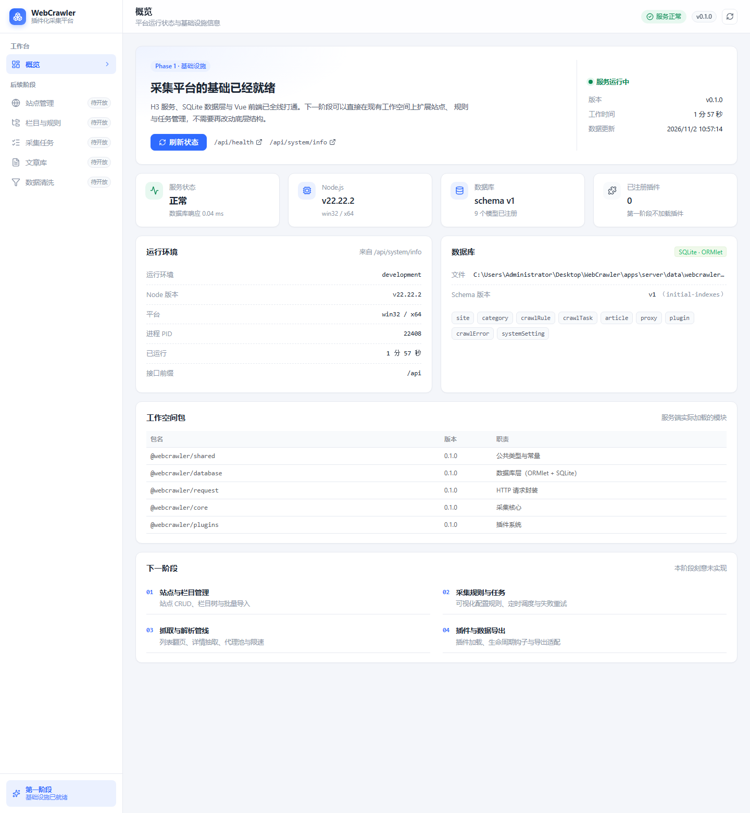
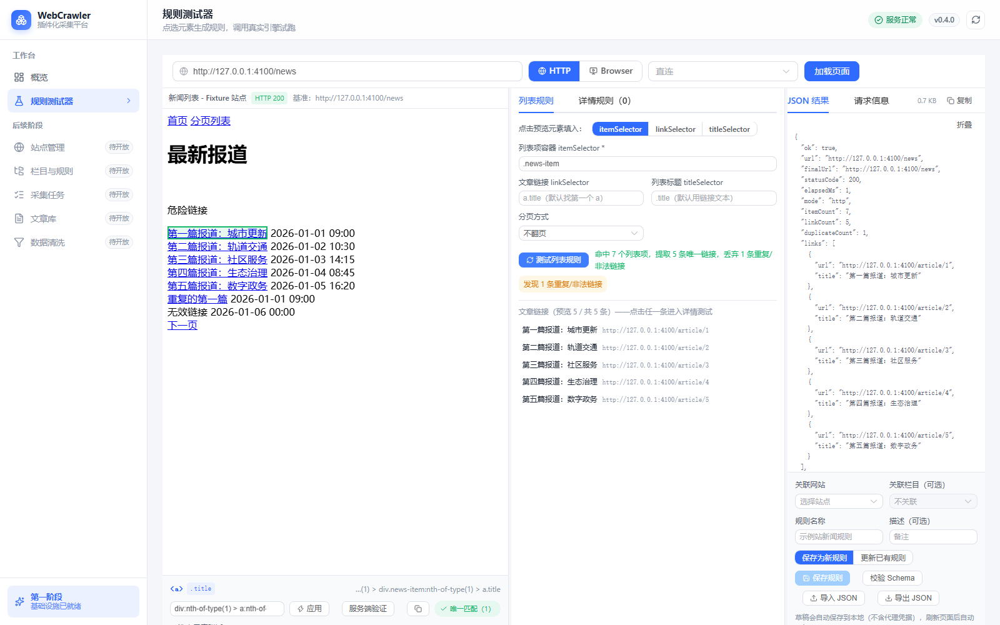

# WebCrawler

插件化网页采集平台。已完成**第一阶段（基础设施）**、**第二阶段（采集核心引擎）**、**第三阶段（站点 / 栏目 / 规则管理）**与**第四阶段（可视化规则测试器）**：
现在可以打开管理后台的「规则测试器」，输入地址、在真实页面里点选 DOM 生成 CSS Selector，
配置列表与详情字段，用与正式采集完全相同的引擎试跑，并把结果保存成可直接执行的采集规则。




## 技术栈

| 层 | 选型 | 版本 |
| --- | --- | --- |
| 运行时 | Node.js（使用内置 `node:sqlite`） | >= 22.13（实测 22.22.2） |
| 包管理 | pnpm workspace | 12.11.2 |
| 语言 | TypeScript | 5.9.3 |
| HTTP 服务 | H3 v2 | 2.0.8 |
| ORM | ORMlet | 2.1.2 |
| 数据库 | SQLite（WAL） | — |
| 请求 | request-pack（axios 1.21） | 1.1.1 |
| 浏览器 | Playwright（Chromium Headless Shell） | 1.64.1 |
| SOCKS5 适配 | socks-proxy-agent | 10.1.0 |
| HTML 解析 | cheerio（CSS）/ linkedom + xpath（XPath） | 1.0.0 / 0.18.15 / 0.0.36 |
| 前端 | Vue 3 + Vite | 3.5.44 / 8.3.5 |
| UI | Element Plus + Lucide | 2.14.7 / @lucide/vue 1.66.0 |
| 校验 | Zod | 4.6.7 |
| 测试 | Vitest | 5.0.5 |

## 目录结构

```
.
├── apps
│   ├── server                  # @webcrawler/server：H3 v2 后端 + 采集核心
│   │   ├── src
│   │   │   ├── server          # 应用组装、中间件、路由、服务层
│   │   │   ├── database        # ORMlet 模型 + 迁移
│   │   │   ├── request         # 统一请求层：HTTP / 浏览器 / 代理 / SSRF
│   │   │   ├── core            # 采集核心：解析、清洗、校验、管道、引擎
│   │   │   ├── plugin-system   # 插件契约、注册表、通用站点插件
│   │   │   └── shared          # 公共类型：API 结构、领域枚举、采集契约
│   │   ├── test                # 后端 Vitest 测试
│   │   └── scripts             # fixture 站点、种子数据、冒烟脚本
│   └── web                     # @webcrawler/web：Vue 3 + Vite 管理后台
│       ├── src
│       └── test                # 前端 Vitest 测试
├── docs
├── tsconfig.base.json          # 两包共享的 TS 基础配置
└── pnpm-workspace.yaml
```

### apps/server/src/request

| 文件 | 职责 |
| --- | --- |
| `http-client.ts` | 统一 HTTP 入口：重定向逐跳校验、流式限流、幂等重试、编码识别、TLS 链自动补全（AIA） |
| `browser-client.ts` | Playwright 封装：复用 Browser、按次隔离 Context、并发页限制 |
| `proxy-resolver.ts` | 代理解析、优先级选择、HTTP/HTTPS/SOCKS5 适配、脱敏 |
| `ssrf-guard.ts` | 协议白名单、IP 段判定、DNS 校验、连接时 lookup 校验 |
| `chain-recovery.ts` | TLS 链自动补全：识别缺中间证书错误，按 AIA 下载缺失证书后安全重试 |
| `request-types.ts` | 请求参数、响应、浏览器结果类型 |
| `request-errors.ts` | 统一 `RequestError` 与错误码 |

### apps/server/src/core

| 文件 | 职责 |
| --- | --- |
| `parser/document.ts` | CSS（cheerio）与 XPath（linkedom + xpath）双适配器 |
| `parser/extract.ts` | 字段提取：单值/多值、嵌套、必填、默认值、匹配数量 |
| `parser/index.ts` | `Parser` 门面：parseHtml / parseJson / extractText / … |
| `clean.ts` | 文本清洗、HTML 清洗（去脚本/事件属性/危险协议）、图片提取 |
| `url.ts` / `json-path.ts` | URL 规范化、相对地址解析、显式 JSON 路径 |
| `pipeline.ts` | 解析 → 清洗 → 校验 → 规范化 → Hash → 输出 |
| `engine.ts` | 列表 → 详情 → ArticleData，单篇失败隔离；`fetchAndParse` 供执行器只抓一次 |
| `task/limiter.ts` | `KeyedLimiter`（全局 + 按 key 并发）、`IntervalLimiter`（栏目间隔）、可取消 `delay` |
| `task/pagination.ts` | 分页 URL 生成（`none` / `query` / `path`），`next` / `cursor` 明确报未实现 |

### apps/server/src/shared

| 文件 | 职责 |
| --- | --- |
| `rule-schema.ts` | 采集规则 JSON Schema（唯一来源）：`zod` 校验、分页类型白名单、字段名与嵌套深度约束 |
| `rule-merge.ts` | 规则归一化与深度合并（站→栏目→任务三层继承） |
| `task-state.ts` | 任务状态机转换表与 `canTransition` / `describeInvalidTransition` |
| `task.ts` / `schedule.ts` / `article.ts` / `proxy.ts` / `log.ts` | 任务、定时、文章、代理、日志的 DTO 与输入约束 |
| `url-normalize.ts` | URL 规范化与营销参数白名单剔除 |
| `dto.ts` | 站点 / 栏目 / 规则 / 版本 / 测试结果的对外 DTO（不含代理凭据） |
| `crawl.ts` / `api.ts` / `errors.ts` | 采集契约、统一响应结构与错误码 |

### apps/server

| 文件 | 职责 |
| --- | --- |
| `routes/*.ts` | 仅解析输入、调用 Service、返回结果；声明式路由表用于 405 判定 |
| `services/site-service.ts` | 站点 CRUD、域名与 baseUrl 校验、状态切换、连接测试 |
| `services/category-service.ts` | 栏目 CRUD、站点内唯一性、规则归属校验 |
| `services/rule-service.ts` | 规则 CRUD、Schema 校验、版本递增与快照、三层生效规则解析 |
| `services/rule-test-service.ts` | 栏目 / 规则试采：复用 `CrawlEngine.listPage()`，与正式采集同源 |
| `services/tester-service.ts` | 规则测试器：页面快照清洗、未保存规则的列表 / 详情试跑、Selector 校验 |
| `services/task-service.ts` | 任务 CRUD、配置快照构建、状态机守卫、列表与统计 |
| `services/task-executor.ts` | 单任务执行：分页、限速、重试、进度与断点、日志 |
| `services/task-runtime.ts` | 队列与并发、暂停 / 恢复 / 取消、重启恢复 |
| `services/schedule-service.ts` / `task-scheduler.ts` | 定时任务 CRUD 与 croner 作业注册（回调只建任务） |
| `services/article-service.ts` | 文章入库、四层去重、查询、删除与流式导出 |
| `services/proxy-service.ts` / `proxy-stats.ts` | 代理 CRUD、密码加解密、连通性测试、使用统计批量 flush |
| `services/log-service.ts` | 日志写入（脱敏）与查询、按保留天数清理 |
| `services/stats-service.ts` | 仪表盘总览：计数、今日采集、成功率、14 天趋势、代理分布 |
| `services/plugin-service.ts` | 插件目录扫描、清单校验、semver 兼容判定、注册表重建、错误日志 |
| `services/settings-service.ts` | 设置白名单与 KV 存储、缓存、运行时生效（并发 / 限速 / 重试 / 日志级别 / 时区 / 默认代理） |
| `lib/crypto.ts` / `proxy-secret.ts` / `redact.ts` | AES-256-GCM 密码、进程级密钥、URL / 字段 / 文本脱敏 |
| `lib/cron.ts` | cron 校验、`nextRunAt` 计算、默认时区 |
| `app-runtime.ts` | 运行时单例：任务运行时、调度器、代理统计定时器与停机清理 |
| `services/common.ts` | DTO 映射、关联实体查找、代理可用性校验与脱敏 |

### apps/web

| 文件 | 职责 |
| --- | --- |
| `api/client.ts` | Axios 统一封装：拆包响应、错误归一（`ApiClientError`）、查询串拼装、文件下载 |
| `api/*.ts` | 11 组业务接口模块（sites / categories / rules / tasks / articles / proxies / logs / schedules / plugins / settings） |
| `components/common/*` | 15 个公共组件：PageHeader、StatCard、DataTable、SearchBar、FilterBar、StatusTag、空/错/加载态、ConfirmDialog、JsonViewer、CodeViewer、LogViewer、Pagination、FormDialog |
| `composables/useListQuery.ts` | 列表页通用状态：分页 + 筛选 + 请求序号守卫 + 删除后页码回退 |
| `composables/useAsyncState.ts` / `usePolling.ts` | 统一异步状态；任务详情的定时轮询（终态自停） |
| `stores/theme.ts` / `stores/app.ts` | 主题三态（浅色 / 暗色 / 跟随系统）与侧栏折叠、数据版本号 |
| `styles/main.css` | 设计 Token（`--wb-*`）+ 暗色覆盖 + Element Plus 变量对齐 |
| `lib/sanitize.ts` | 浏览器端 HTML 二次清洗（白名单标签 / 属性、拦伪协议），正文渲染最后一道防线 |
| `views/*.vue` | 13 个页面（仪表盘、网站、栏目、规则、测试器、任务、任务详情、文章、文章详情、代理、插件、日志、设置） |
| `views/RuleTesterView.vue` | 三栏测试器：预览 / 配置 / 结果，支持拖动分栏与草稿恢复 |
| `preview/selector-generator.js` | CSS Selector 生成器（id → class 组合 → 父级锚点 → nth-of-type），每个候选都在真实 DOM 验证 |
| `preview/preview-agent.js` | 注入 sandboxed iframe 的点选代理，仅通过受控 postMessage 协议通信 |
| `components/tester/*` | 预览、选择器栏、列表/详情配置、结果面板、保存面板 |
| `composables/useTesterDraft.ts` | 草稿持久化（容量上限、结构校验、不含代理凭据） |

## 快速开始

```bash
pnpm install
npx playwright install chromium   # 首次使用浏览器模式时执行（约 118 MB）
pnpm db:init                      # 创建 SQLite 文件并执行迁移
pnpm fixture                      # 可选：本地验收站点 http://127.0.0.1:4100
pnpm dev                          # 后端 :3000 + 前端 :5173
```

需要保存带密码的代理时，先配置加密密钥（不配置时写入带密码的代理会被 503 拒绝）：

```bash
PROXY_SECRET_KEY=dev-secret-key-0123456789 pnpm dev
```

构建与校验：

```bash
pnpm build            # 按依赖拓扑构建全部工作空间
pnpm typecheck        # 全部工作空间类型检查（含 vue-tsc）
pnpm test             # Vitest，371 个用例（36 个测试文件）
```

第四阶段界面冒烟（需先启动 fixture、后端与前端）：

```bash
node apps/server/scripts/smoke-tester.mjs
```

自动打开规则测试器、加载 fixture 列表页、点选 DOM、跑列表与详情测试，并刷新 `docs/stage4-tester*.png`。

第六阶段界面冒烟（需先启动 fixture、后端与前端）：

```bash
node scripts/seed-demo.mjs     # 通过真实接口造一份演示数据（站点/规则/栏目/任务/代理/插件）
node scripts/ui-smoke.mjs      # 逐页加载 + 截图 + 控制台错误检查 + 主题/路由/按钮行为
```

覆盖 13 个页面与浅色/暗色两套主题，任何控制台错误都会让脚本以非 0 退出；截图输出到 `tmp/screenshots/`。

采集链路演示（本地 fixture 站点，不访问外网）：

```bash
pnpm --filter @webcrawler/core demo:crawl
```

输出列表链接、管道每个阶段的耗时、第一篇文章的完整 `ArticleData` 与失败记录。

## 环境变量

| 变量 | 默认值 | 说明 |
| --- | --- | --- |
| `HOST` | `127.0.0.1` | 监听地址 |
| `PORT` | `3000` | 监听端口 |
| `DATABASE_FILE` | `<cwd>/data/webcrawler.db` | SQLite 文件，父目录自动创建 |
| `CORS_ORIGIN` | `*` | `*` 或逗号分隔来源白名单 |
| `LOG_LEVEL` | `info` | `debug` / `info` / `warn` / `error` |
| `NODE_ENV` | `development` | `production` 时隐藏 500 的原始错误信息 |
| `ALLOW_PRIVATE_NETWORK` | `false` | 允许访问私网地址（仅本地联调 / 试采用，生产必须保持 `false`） |
| `PROXY_SECRET_KEY` | 无 | 代理密码加密密钥（≥16 字符）。**未配置时禁止写入带密码的代理**（503 `CONFIGURATION_ERROR`），绝不硬编码 |
| `TASK_CONCURRENCY` | `2` | 后台任务全局并发数（1-32） |
| `TASK_SITE_CONCURRENCY` | `1` | 单站点同时运行的任务数（1-16） |
| `TASK_RATE_LIMIT_MS` | `300` | 同一栏目两次请求的最小间隔（1-60000） |
| `SCHEDULER_ENABLED` | `true` | 是否启动定时任务调度器（`false` 时任务仍可手动创建） |
| `PROXY_TEST_URL` | `https://www.example.com` | 代理连通性测试的默认目标地址 |
| `PLUGIN_DIR` | `<cwd>/plugins` | 本地插件目录，`/api/plugins/scan` 默认扫描这里 |
| `VITE_API_BASE_URL` | `/api` | 前端接口前缀 |

## API 约定

所有响应（含错误）结构一致：

```json
{ "success": true, "data": {}, "meta": { "requestId": "…", "timestamp": "…" } }
```

```json
{
  "success": false,
  "error": { "code": "VALIDATION_ERROR", "message": "查询参数校验失败", "details": [] },
  "meta": { "requestId": "…", "timestamp": "…" }
}
```

- 错误码：`BAD_REQUEST`、`VALIDATION_ERROR`、`NOT_FOUND`、`METHOD_NOT_ALLOWED`、`CONFLICT`、`DATABASE_UNAVAILABLE`、`CONFIGURATION_ERROR`（缺少必要配置，如 `PROXY_SECRET_KEY`）、`INTERNAL_ERROR`。
- 状态码：200 / 201（带 `Location`）/ 400 / 404 / 405（带 `Allow`）/ 409 / 503 / 500。
- 列表接口统一返回 `{ items, total, page, pageSize, totalPages }`，`pageSize` 默认 20，上限 100（超出返回 400，不静默截断）。

### 已实现接口

| 方法 | 路径 | 说明 |
| --- | --- | --- |
| GET | `/api/health` | 健康检查（含版本与数据库状态） |
| GET | `/api/system/info` | 运行信息，`?verbose=true` 追加内存与监听信息 |
| GET / POST | `/api/sites` | 站点列表（`page`/`pageSize`/`keyword`/`status`/`pluginName`）/ 新建站点（域名从 `baseUrl` 主机名自动获取，无需提交 `domain`） |
| GET / PUT / PATCH / DELETE | `/api/sites/:id` | 详情（含栏目/规则/任务/文章计数）、全量替换、部分更新、删除 |
| PATCH | `/api/sites/:id/status` | 启用 / 停用 |
| POST | `/api/sites/:id/test` | 连接测试：发一次 GET，返回状态码、耗时与 `<title>` |
| GET | `/api/sites/:id/categories` | 该站点下的栏目 |
| GET / POST | `/api/categories` | 栏目列表（`siteId`/`keyword`/`enabled`）/ 新建 |
| GET / PUT / PATCH / DELETE | `/api/categories/:id` | 详情、替换、更新、删除 |
| PATCH | `/api/categories/:id/status` | 启用 / 停用 |
| POST | `/api/categories/:id/test` | 栏目试采：走生效规则抓一次列表 |
| GET / POST | `/api/rules` | 规则列表（`siteId`/`categoryId`/`status`/`scope`/`keyword`）/ 新建（同时写入 v1 快照） |
| GET / PUT / PATCH / DELETE | `/api/rules/:id` | 详情、替换、更新、删除 |
| PATCH | `/api/rules/:id/status` | 启用 / 停用 |
| POST | `/api/rules/resolve` | 解析生效规则（站点默认 → 栏目 → 任务覆盖），返回合并结果与来源 |
| GET | `/api/rules/:id/versions` | 版本列表（新 → 旧） |
| GET | `/api/rules/:id/versions/:version` | 指定版本快照 |
| POST | `/api/rules/:id/test` | 规则试采，可传 `listUrl` 覆盖 |
| GET / POST | `/api/proxies` | 代理列表（`type`/`enabled`/`keyword`，永不返回密码，只给 `hasPassword`）/ 新建 |
| GET / PUT / PATCH / DELETE | `/api/proxies/:id` | 详情、替换、更新（`password: null` 清空）、删除（被引用时 409，`?force=true` 解除引用） |
| PATCH | `/api/proxies/:id/status` | 启用 / 停用 |
| POST | `/api/proxies/:id/test` | 连通性测试（10s 超时，返回 `ok`/`status`/`durationMs`/`error`，并回写 `lastTestAt`） |
| GET / POST | `/api/tasks` | 任务列表（`siteId`/`status`/`type`/`keyword`）/ 创建（立即返回 `pending` + `Location`，后台执行） |
| GET / DELETE | `/api/tasks/:id` | 任务详情（含 `configSnapshot`、`checkpoint`、进度）/ 删除（running / pending 拒绝，409） |
| POST | `/api/tasks/:id/pause` | 暂停（停止分发新请求，保留断点） |
| POST | `/api/tasks/:id/resume` | 恢复（回到 `pending` 重新入队，按断点续跑） |
| POST | `/api/tasks/:id/cancel` | 取消（`AbortSignal` 中断当前请求，状态 `cancelled`） |
| POST | `/api/tasks/:id/retry` | 重试 `failed` / `cancelled` 任务（`attempts` 由执行器递增） |
| GET | `/api/articles` | 文章列表（`keyword`/`siteId`/`categoryId`/`taskId`/`status`/`publishedFrom`/`crawledFrom`/`sort`） |
| GET | `/api/articles/export` | 导出 `format=json\|csv`，流式返回，单次上限 5000（`x-export-limit` 标出实际限额） |
| GET / DELETE | `/api/articles/:id` | 文章详情（正文 / 图片 / JSON 扩展）/ 单篇删除 |
| GET | `/api/articles/:id/raw` | 原始 HTML（入库时截断至 512 KB） |
| POST | `/api/articles/batch-delete` | 批量删除（单次最多 100 条，返回 `deleted` 与 `missing`） |
| GET | `/api/logs` | 任务日志（`taskId`/`siteId`/`categoryId`/`level`/`stage`/`keyword`/`from`/`to`），写入时已脱敏 |
| GET / POST | `/api/schedules` | 定时任务列表（`siteId`/`enabled`）/ 新建（`hourly`/`daily`/`weekly`/`cron` + 时区） |
| GET / PUT / PATCH / DELETE | `/api/schedules/:id` | 详情、替换、局部更新（改小时会自动重算 cron 与 `nextRunAt`）、删除 |
| PATCH | `/api/schedules/:id/status` | 启用 / 停用（同时增删 croner 作业） |
| POST | `/api/schedules/:id/run` | 手动触发一次：只创建 `pending` 任务，同栏目有活动任务时 `skipped=true` |
| POST | `/api/tester/snapshot` | 页面快照：清洗后的 HTML + 标题 + 最终 URL + 状态码 + 耗时 |
| POST | `/api/tester/list` | 未保存的列表规则试跑（真实请求层 + `CrawlEngine.listPage`） |
| POST | `/api/tester/detail` | 未保存的字段映射试跑（同一条 `runPipeline`） |
| POST | `/api/tester/selector` | 在真实文档中验证 Selector 匹配数量（支持 CSS / XPath） |
| POST | `/api/tester/rule/validate` | 用第三阶段 Schema 校验规则 JSON |
| DELETE | `/api/sites/:id`、`/api/categories/:id`、`/api/rules/:id` | 默认「限制删除」，带 `?force=true` 只解除配置引用 |

删除语义：有文章或历史任务时一律返回 409（`details` 给出 `counts`），`force=true` 也不会删除文章与任务记录，只解除栏目/站点对规则的引用。

## 采集规则结构

规则是可校验的 JSON，Schema 定义在 `apps/server/src/shared/rule-schema.ts`，是服务端校验与后续调度执行的唯一来源（所有对象 `strict`，拼写错误直接 400，不会被忽略）。

```json
{
  "version": 1,
  "request": { "mode": "http", "timeoutMs": 15000, "headers": { "referer": "https://example.com/" } },
  "list": { "itemSelector": ".news-item", "linkSelector": "a", "titleSelector": ".title" },
  "pagination": { "type": "query", "parameter": "page", "start": 1, "maxPages": 5 },
  "detail": {
    "fields": {
      "title": { "type": "text", "selector": "h1", "required": true },
      "content": { "type": "html", "selector": ".article-content" },
      "images": { "type": "attr", "selector": "img", "attribute": "src", "multiple": true },
      "cover": { "type": "attr", "selector": ".article-cover img", "attribute": "src" },
      "author": { "type": "text", "selector": ".author", "defaultValue": "佚名" }
    }
  },
  "clean": { "removeSelectors": [".ad"] },
  "validate": { "minContentLength": 10 },
  "browser": { "enabled": false }
}
```

- `type`：`text` / `html` / `attr` / `list` / `object`；`list`/`object` 可无限嵌套字段映射。
- `selectorType`：`css`（默认）或 `xpath`。XPath 使用独立适配器，不做字符串替换伪装。
- `jsonPath`：JSON 响应使用，如 `data.items[*].url`。
- `required` / `defaultValue` / `multiple` / `clean`：必填、兜底、多值与字段级清洗。
- 标准字段：`title` / `url` / `author` / `summary` / `content` / `coverUrl` / `articleTime`——列表规则与详情规则共用同一套内置字段；
  其余字段名进入文章的 `extra` 扩展 JSON。封面图是**预留字段且允许为空**：规则没映射、页面没有或地址不是 http(s) 时为 `null`。
  旧规则里的 `cover` / `publishTime` 仍可读取，分别等价于 `coverUrl` / `articleTime`。
- 字段名需匹配 `^[A-Za-z_][A-Za-z0-9_]{0,63}$`，嵌套深度上限 8 层（防止递归爆栈）。
- `detail.fields` 与顶层 `fields` 不允许同时出现；`request.mode=http` 与 `browser.enabled=true` 互斥，冲突时报错而不是「后者静默生效」。

### 分页类型

| 类型 | 配置校验 | 说明 |
| --- | --- | --- |
| `none` | 通过 | 不翻页，默认值 |
| `query` | 通过 | 需要 `parameter`（页码参数名），可配 `start` / `maxPages` |
| `path` | 通过 | 需要 `pathPattern`（如 `/page/{page}`），校验生成地址与站点同源 |
| `next` / `cursor` | **拒绝** | 返回 400「分页类型 next 尚未实现」，绝不静默当作单页 |

本阶段只做「配置可被可靠校验与保存」，多页抓取执行在后续阶段接入同一份配置；
因此现在保存 `query` / `path` 不会报错，但试采与采集引擎仍只抓取入口页。

### 规则继承与深度合并

生效规则按 `站点默认规则 < 栏目覆盖规则 < 任务临时覆盖规则` 三层合并，实现只有一处：`apps/server/src/shared/rule-merge.ts`。

| 场景 | 行为 |
| --- | --- |
| 两者都是对象 | 按 key 递归合并，未出现的 key 保留基础值 |
| 数组（如 `clean.removeSelectors`、`headers` 白名单） | **整体替换**，不拼接、不去重 |
| 标量（字符串 / 数字 / 布尔） | 覆盖，`false` / `0` / `""` 也是有效覆盖值 |
| `null` | 清除该配置，目前仅允许出现在 `request.proxy`（表示「不走代理」） |
| `fields` | 按字段名逐层合并：覆盖方只写 `title.selector` 时，`title.required` 仍保留基础值 |

因此不存在「浅合并导致字段丢失」：`mergeRuleConfig` 与 `isDeepEqual` 有 16 个单测覆盖，包括嵌套对象、数组替换、null 清除、字段映射局部覆盖。

`POST /api/rules/resolve` 一次性返回 `config`（合并后）、`sources`（每层规则的 id 与版本）、`mergeStrategy`（上述策略的机器可读说明），便于排查「为什么这次抓取用了这个选择器」。

### 版本管理

- 新建规则即写入 `version = 1` 的快照到 `crawl_rule_version`。
- 只有 `config` 真正变化时才 `version + 1` 并追加快照；改名称/描述不产生版本。
- 版本记录只增不改：`GET /api/rules/:id/versions/:version` 读取历史配置，`PUT` 永远不会覆盖旧版本。
- `crawl_task` 冗余保存 `ruleVersion` 与 `ruleSnapshot`，任务运行时把当时的配置固化下来，后续规则调整不影响历史任务的可追溯性。
- 版本不存在时返回 404，并在 `details.available` 里列出实际存在的版本号。

### 规则试采

`POST /api/sites/:id/test`、`POST /api/categories/:id/test`、`POST /api/rules/:id/test` 都只是薄包装，最终都调用 `CrawlEngine.listPage()`——与正式采集同一套引擎、同一套清洗与解析，不存在「测试能过、正式抓不到」的分叉实现。

- 代理优先级：规则 `request.proxy` > 栏目 `proxyId` > 站点 `defaultProxyId` > 直连。
- 返回 `items`、`links`、`status`、`mode`、`elapsedMs`、`finalUrl`，抓取失败（如 503）以 `ok: false` + `message` 返回，不抛 500。
- 本地测试需要 `ALLOW_PRIVATE_NETWORK=true`，否则 SSRF 校验会拒绝 `127.0.0.1`。

## 可视化规则测试器

`/tester` 是一个三栏开发者工具：左边预览网页、中间配置选择器与字段、右边看 JSON 与请求信息。分栏可拖动，窄屏自动改为纵向排列。

**页面预览与隔离**

- 快照由服务端获取并清洗：移除 `script` / `style` / `iframe` / `object` / `embed` / `form` / `link` / `meta`、所有 `on*` 事件属性与 `javascript:` 地址，再注入 `<base>` 让相对地址可解析。
- 快照放进 `sandbox="allow-scripts"`（无 `allow-same-origin`）的 iframe：目标是 opaque origin，读不到后台的 cookie / localStorage / DOM。
- 目标站点脚本不可能执行；注入的点选代理只通过受控消息协议通信，父页面同时校验 `event.source === iframe.contentWindow` 与消息结构。
- 预览内点击一律 `preventDefault`，不允许导航；需要看别的页面就回顶部重新加载（重新走 SSRF 校验）。
- 从不把未清洗 HTML `v-html` 进管理后台。

**Selector 生成**

1. 稳定且唯一的 `id`；
2. 稳定 class 组合（过滤 `css-1q2w3e`、`sc-xxxx` 这类构建产物类名）；
3. 有意义的父级锚点 + 相对路径；
4. `:nth-of-type` 位置路径兜底。

每个候选都要在真实 DOM 里 `querySelectorAll` 验证「命中唯一且包含目标元素」，不靠 class 字符串猜唯一性；界面显示匹配数量并区分唯一 / 多匹配 / 无匹配 / 语法非法，可手动改写后在 iframe 内或服务端（支持 XPath）重新验证。

**配置与保存**

- 字段配置与第三阶段 Rule Schema 同构（`text` / `html` / `attr`、`multiple`、`required`、`defaultValue`、字段级清洗），保存后可直接被采集引擎执行。
- 支持保存为新规则 / 更新已有规则、关联网站与栏目、导入导出 JSON。
- 草稿自动存 localStorage（上限 512 KB，超限明确提示且不静默丢弃），刷新恢复，离开页面前提示未保存修改；草稿只存 `proxyId` 引用，不含任何代理凭据。

**验收 fixture**

`pnpm fixture` 提供固定站点，覆盖普通列表、重复链接、`javascript:` 链接、页码 / 路径 / 下一页分页、正文图片、SPA、XSS 与 404；`apps/server/test/tester.test.ts` 用它验证脚本隔离、XSS 清洗、Selector 无/多匹配、必填缺失与 SSRF 拦截。

## 统一请求层

- **代理优先级**：任务 > 栏目 > 网站 > 系统 > 直连（`resolveProxy`）。
- **HTTP / HTTPS 代理**：使用 request-pack 原生 `proxy` 配置（axios 1.16+ 的 CONNECT 隧道）。
- **SOCKS5**：通过 `socks-proxy-agent` 作为 `httpAgent` / `httpsAgent` 接入；SOCKS4 明确返回 `UNSUPPORTED`，不静默直连。
- **重定向**：`maxRedirects: 0` 手动跟随，逐跳重新执行 SSRF 校验并记录每一跳。
- **响应体上限**：流式读取，超限立即中断（`RESPONSE_TOO_LARGE`），默认 5 MiB。
- **重试**：只对 GET / HEAD 与 408/425/429/5xx 生效；POST 永不自动重发。
- **编码**：使用 request-pack 的 `detectCharset` + `iconv-lite` 解码，GBK 站点不乱码。
- **元数据**：状态码、响应头、最终 URL、重定向链、耗时、各跳耗时。
- **敏感信息**：`formatProxyForLog` 只输出协议、主机与端口，密码不进入日志与错误。

### SSRF 防护

1. 协议白名单：仅 `http` / `https`。
2. 请求前校验：`localhost`、`*.local`、云元数据域名黑名单；IPv4/IPv6 私网、回环、链路本地、保留段（含 `::ffff:127.0.0.1`、NAT64）；DNS 解析结果全部检查。
3. 连接时校验：注入自定义 `lookup`，在建立连接的一刻再过滤解析结果，防止 DNS rebinding。
4. 浏览器模式：`context.route` 拦截每个导航请求（含重定向与 iframe），导航结束再校验最终地址。

本地 fixture 测试需显式传入 `ssrf: { allowPrivateNetwork: true }`；生产默认严格。

## 结果与去重

- `ArticleData` 同时保存 `content`（纯文本）、`html`（清洗并转绝对地址）、`images`（去重后的绝对地址）、`coverUrl`（封面图，可为空）、`contentHash`（标题 + 正文的 SHA-256）。
- 封面图落库规则：规则映射的 `cover` / `coverUrl` 优先（相对地址按文章地址补全），缺省回退正文首图，两者都没有则为 `NULL`；只接受 http(s)，不把伪协议写进库。
- `contentHash` 用于增量去重：同一页面重复采集得到相同 Hash，命中即 `skipped` 且不覆盖原记录。
- 单篇失败不会中断整批采集，错误按 URL 收集（`stage` / `code` / `message`）并写入任务日志。

## 任务调度与执行

### 任务状态机

六个状态集中在 `apps/server/src/shared/task-state.ts`，API、服务层、运行时与执行器共用同一张转换表；非法转换一律 409，并在 `details` 里给出允许的目标状态。

```
pending ──▶ running ──▶ completed
   │           │  │
   │           │  └──▶ failed ──▶ pending（retry）
   │           ▼
   ├──────▶ paused ──▶ pending（resume）
   └──────▶ cancelled ──▶ pending（retry）
running ──▶ cancelled
```

- `completed` / `failed` / `cancelled` 是终态，终态之间不能互转。
- 创建任务只写库 + 入队，HTTP 响应立即返回 `201 pending`，**执行完全脱离请求生命周期**。
- 顺序保证：`TaskRuntime.pump()` 先确认状态仍是 `pending` 才占用并发名额，占用后再确认一次，避免排队期间被暂停/取消的任务被启动。

### 并发与限速

| 层级 | 实现 | 默认值 |
| --- | --- | --- |
| 全局任务并发 | `KeyedLimiter`（FIFO，可 `AbortSignal` 取消） | `TASK_CONCURRENCY=2` |
| 单站点任务并发 | 同上的按 key 计数，key = `siteId` | `TASK_SITE_CONCURRENCY=1` |
| 单栏目请求间隔 | `IntervalLimiter`（同 key 串行 + 最小间隔） | `TASK_RATE_LIMIT_MS=300` |
| 任务总时长 | `AbortSignal.any([控制信号, AbortSignal.timeout(maxDurationMs)])` | 30 分钟 |
| 单篇重试 | 仅失败重试，退避 `300ms × 尝试次数` | `options.retries=1` |

暂停 = 置 `pauseRequested`，执行器在每个链接前检查，**不再分发新请求**，当前请求自然结束；取消 = `AbortController.abort()`，与超时信号合并，网络层立即中断。

### 重启恢复

启动时 `TaskRuntime.recover()` 扫描全部非终态任务（`runtime.recoveredTasks` / `interruptedTasks` / `schedules` 会打进启动日志）：

| 重启前状态 | 处理 |
| --- | --- |
| `running` | **一律置 `failed`**，`errorSummary` 写明「服务重启导致任务中断」，断点保留供 `retry` |
| `pending` | 校验快照存在 → 站点存在 → 规则可执行，通过则重新入队；否则置 `failed` 并写明原因 |
| `paused` | 保持暂停，等用户显式 `resume` |
| 终态 | 完全跳过，不会无条件重跑 |

断点 `checkpoint` 结构：`{ completedCategoryIds, page, processedUrls(≤5000), lastUrl, updatedAt }`，每 800ms 或跨页时合并落盘（并非每篇文章一次 UPDATE）。恢复后已处理的 URL 计入 `skipped`，不再重复请求，进度条也不会「越跑越少」。

### 定时任务

- 依赖 `croner`（轻量、无外部服务），支持 `hourly` / `daily` / `weekly` / `cron` 四种配置，`buildCronExpression` 统一生成表达式。
- 时区默认取 `TZ`，否则系统时区；显式配置时用 `Intl.DateTimeFormat` 校验合法性。
- 回调**只创建 `CrawlTask`**（`trigger=schedule`），不在 cron 回调里跑采集。
- 防重复三重判定：`firing` Set（同一次触发重入）、同 schedule 已有活动任务、同栏目已有活动任务。
- 重启后按 `enabled` 重新注册；`PATCH` 改时间表会先停旧作业再建新作业，并刷新 `nextRunAt`。

### 增量与去重

四层递减，全部命中才算「同一篇文章」：

1. **任务级 Set**：`seen`（本轮发现计数）+ `processed`（断点内已处理），进程内零开销。
2. **URL 规范化**：去锚点、主机小写、剥离默认端口、query 按 key 排序，只剔除白名单营销参数（`utm_*`、`gclid`、`fbclid`、`spm` 等），绝不模糊删除 `ref` / `from` 这类可能是业务语义的参数。
3. **数据库唯一索引** `ux_article_url`：并发写入的最后一道闸。
4. **内容 Hash**：同 URL 内容未变 → `skipped`；内容有变 → 更新并保留新的 `contentHash` 与 `crawlTime`；Hash 命中其他 URL → 判为转载，`skipped`。

`type=incremental` 额外按 `lastCrawlTime` / `publishedAfter` 过滤，只补新文章。

### 文章与导出

- 列表走 `runRawList`（参数绑定 + `ESCAPE '\'`），关键词命中标题 / 摘要 / 正文。
- `rawHtml` 入库截断 512 KB，`extra` 截断 16 KB，`images` 存 JSON 数组；`coverUrl` 为空时导出为空单元格，不补默认图。
- 导出用 `ReadableStream` + 分批 SQL（`LIMIT/OFFSET`，每批 200），单次硬上限 5000 条，CSV 带 BOM + CRLF，避免 Excel 乱码。

### 代理与密码

- `password` 用 AES-256-GCM 加密后入库，密钥由 `PROXY_SECRET_KEY` 经 scrypt 派生（固定盐 `webcrawler:proxy:v1`），存储格式 `enc:v1:<iv>:<tag>:<data>`。
- 未配置密钥时**拒绝写入带密码的代理**（503 `CONFIGURATION_ERROR`），不退化为明文；历史明文记录仍可读取，重新保存即完成迁移。
- API 只返回 `hasPassword`，任何响应与日志都不含密码。
- 使用统计（`requestCount` / `successCount` / `failCount` / `lastUsedAt`）在内存累加，5s 批量 flush，停机时强制落盘，避免每篇文章一次 UPDATE。

### 日志与脱敏

`writeLog` 在写库前统一脱敏，日志失败静默跳过（不影响采集主流程）：

- URL：userinfo 替换为 `***`，敏感 query key（`token` / `password` / `signature` / `session` / `key` 等）值替换为 `***`，参数名与顺序保留。
- 结构化 `detail`：深度 6 层脱敏，命中 `password` / `secret` / `token` / `authorization` / `cookie` / `apiKey` 的键整体替换。
- 文本：`Bearer xxx` 与 `password=xxx` 这类内联凭据被抹掉。

## 数据库

12 个模型：`Site`、`Category`、`CrawlRule`、`CrawlRuleVersion`、`CrawlTask`、`CrawlSchedule`、`CrawlLog`、`Article`、`Proxy`、`Plugin`、`CrawlError`、`SystemSetting`。

- 模型统一定义在 `apps/server/src/database/models`，进程内只有一个连接，业务模块通过 `getModels()` 取用。
- 迁移在 `apps/server/src/database/migrations`：`_migrations` 记录版本，每个迁移独立事务。
- `001-initial-indexes`：随模型同步的完整索引集，新库一次建好。
- `002-stage3-upgrade`：第三阶段增量升级，用于老库原地演进——`site.url → baseUrl`（按域名补 `https://`）、`site.remark → description`、`category.url → listUrl`、`category.status → enabled`、`crawl_rule` 旧选择器列折叠成合法 JSON，并补 v1 版本快照、回填 `crawl_task.ruleVersion`。已在真实的旧库副本上验证列变更无数据丢失。
- `003-stage5-indexes`：第五阶段索引——任务（`siteId+status`、`status+createdAt`、`scheduleId`）、文章（`contentHash`、`crawlTime`）、代理（`enabled`）、`ux_crawl_schedule_name`、日志（`taskId+id`、`level`、`createdAt`）。
- 唯一索引：`site.domain`、`category(siteId,listUrl)`、`category(siteId,code)`、`crawl_rule(siteId,name)`、`crawl_rule_version(ruleId,version)`、`article.url`、`crawl_schedule.name`、`proxy(protocol,host,port)`、`plugin.name`、`system_setting.settingKey`。

### ORMlet 的边界（有意为之）

ORMlet 只接受 `TEXT` / `INTEGER` / `REAL` / `BLOB`，不支持 `NOT NULL`、`DEFAULT`、`BOOLEAN`、外键：

- 布尔用 `INTEGER`（0/1），状态用 `TEXT` 存枚举。
- 时间存 ISO 8601 字符串，`createdAt` / `updatedAt` 由 ORMlet 维护。
- 唯一索引保证唯一性；SQLite 唯一索引不约束 `NULL`，必填与默认值由业务层兜底。
- 关系用 `*Id` 整型字段 + 索引表达。
- 列表分页需要 `LIKE` 与稳定排序，走 `apps/server/src/lib/query.ts` 的 `runRawList`：表名、列名、排序方向都是代码常量，用户输入只作为参数绑定值（含 `ESCAPE '\'` 转义 `%` / `_`），不存在字符串拼接注入。

## 第六阶段：管理后台

把第二到第五阶段的真实 API 组装成一套可用的 Web 后台。**没有静态假数据**：所有数字、列表、进度、日志都来自 H3 接口，无数据时显示空状态而不是造数据。

### 页面清单

| 路由 | 页面 | 主要能力 |
| --- | --- | --- |
| `/` | 仪表盘 | 网站/栏目/文章总数、今日采集、执行中任务、近 30 天成功率、代理可用、14 天趋势图（ECharts）、最近任务、最近错误 |
| `/sites` | 网站管理 | 列表 / 新增 / 编辑 / 删除 / 测试连接 / 启停 / 搜索筛选 / 跳转栏目管理（域名不手填，由站点地址自动获取） |
| `/categories` | 栏目管理 | 列表 / 新增 / 编辑 / 删除 / 网站筛选 / 规则与代理绑定 / 启停 / 单栏目采集 / 批量采集 / 试采 |
| `/rules` | 采集规则 | 列表 / 新建 / 编辑 / 复制 / 删除 / 导入 JSON / 导出 JSON / 版本时间线 / 跳转测试器 |
| `/tester` | 规则测试器 | 三栏可拖动：页面加载、HTTP / Browser 切换、代理选择、DOM 快照、悬停高亮、点选生成 Selector、列表与详情测试、保存规则 |
| `/tasks` | 采集任务 | 列表 / 新建（5 种类型）/ 暂停 / 恢复 / 取消 / 重试 / 删除 / 列表自动刷新 |
| `/tasks/:id` | 任务详情 | 真实进度轮询（3s，终态自停）、四类计数、配置快照、执行断点、执行日志、控制按钮 |
| `/articles` | 文章数据 | 关键词 / 网站 / 栏目 / 状态 / 时间筛选、批量选择、批量删除、JSON 与 CSV 导出 |
| `/articles/:id` | 文章详情 | 正文排版、纯文本、图片预览、原始 HTML、JSON、删除 |
| `/proxies` | 代理管理 | 列表 / 新增 / 编辑 / 删除 / 启停 / 连通性测试 / 使用统计，密码只显示「已配置」 |
| `/plugins` | 插件管理 | 已登记插件列表、详情、配置、错误日志、扫描本地目录、重建注册表 |
| `/logs` | 日志中心 | 任务 / 网站 / 级别 / 阶段 / 时间 / 关键词筛选、展开详情、复制、跳转任务 |
| `/settings` | 系统设置 | 分组表单（请求 / 任务 / 浏览器 / 日志 / 系统）、生效方式标注、只读运行信息、脏值保存与撤销 |

### 设计体系

- 全部颜色、圆角、间距、阴影走 `--wb-*` CSS 变量；暗色通过 `html.dark` 覆盖同一组变量，Element Plus 变量同步对齐，不写第二套样式。
- 主题三态：浅色 / 暗色 / 跟随系统，选择写入 `localStorage`，系统主题变化时实时跟随。
- 布局：左侧分组导航（可折叠） + 顶部面包屑/系统状态/版本/主题切换 + 主内容限宽。≤960px 时侧栏改为抽屉：默认移出视口，顶栏汉堡按钮唤出，带遮罩、点导航自动关闭、展开时锁背景滚动。
- 卡片：`.wb-card` 默认带内边距（`--wb-card-padding`），避免标题、表单、键值表贴边；需要内容铺满的场景用 `.wb-card--flush` 显式关掉，由内部组件自己控制留白。
- 统一状态组件：加载骨架、空状态（带下一步动作）、错误状态（带重试与可展开详情）、删除二次确认。

### 关键实现

- **接口层**：Axios 实例统一 `baseURL`、25s 超时、响应拆包与错误归一；`ApiClientError` 携带 `code`/`status`/`details`，401/403/404/409/500/超时/断网都有中文文案；导出走 `responseType: 'blob'`，失败时把 Blob 读回 JSON 还原真实错误。
- **列表页**：`useListQuery` 统一分页、筛选、请求序号守卫（快速切筛选不会被旧响应覆盖）、删完最后一页自动回退页码。
- **任务进度**：只在 `pending`/`running` 时轮询，进入终态立刻停表；进度、页数、四类计数全部读服务端。
- **HTML 预览**：服务端落库前已清洗一次，前端渲染前再用 `sanitizeHtml()` 走白名单二次清洗（丢 script/style/iframe、去 `on*`、拦 `javascript:`），纵深防御；正文限宽 820px，避免长文一行读不完。
- **站内相对图片**：清洗阶段只拦伪协议，不把「无协议相对地址」当危险链接删掉，随后统一按文章地址转绝对路径，`upload/2026/a.jpg` 这类写法不会再丢图。
- **设置生效**：`/api/settings` 只接受白名单键；保存后立即作用到运行时（任务并发、限速、重试、日志级别、时区、默认代理），进程重启时也会重放上次保存值。
- **插件管理**：扫描本地目录的 `plugin.json` 登记清单，semver 判定核心版本兼容性；不兼容自动禁用并写日志，但不会让服务启动失败；启动时按数据库启用状态重建注册表。

### 生产构建与部署

```bash
pnpm build                      # shared → database/request/core/plugins → server(dist) + web(dist)
pnpm --filter @webcrawler/server start        # 或 node apps/server/dist/index.js
```

- 前端产物在 `apps/web/dist`，是纯静态文件，交给 Nginx / Caddy 托管即可；后端只需暴露 `/api`。
- 前后端同域部署时把 `dist` 的 404 回退到 `index.html`（history 路由），并把 `/api` 反代到后端；跨域部署时构建前设置 `VITE_API_BASE_URL`。
- 后端需要的环境变量见上一节；`DATABASE_FILE` 指向的目录必须可写，SQLite 单文件部署，备份即复制该文件。
- 生产必须保持 `ALLOW_PRIVATE_NETWORK=false`，并配置 `PROXY_SECRET_KEY`（否则带密码的代理写入会被拒绝）。

## 阶段边界

已完成（第五阶段）：任务数据模型与状态机、后台任务执行器（排队 / 并发 / 限速 / 暂停恢复取消 / 超时 / 重试 / 进度统计）、重启恢复、定时任务（croner）、增量与四层去重、文章管理（筛选 / 详情 / 原始 HTML / 批量删除 / JSON 与 CSV 流式导出）、代理 CRUD（加密存储、连通性测试、使用统计）、日志与全链路脱敏，以及 `/api/tasks`、`/api/articles`、`/api/proxies`、`/api/logs`、`/api/schedules` 五组接口。

已完成（第六阶段）：`/api/stats/overview`、`/api/plugins`、`/api/settings` 三组接口；13 个管理页面、15 个公共组件、设计 Token 与暗色主题、统一 Axios 封装与错误处理、任务进度轮询、HTML 二次清洗、插件扫描与启停、设置即时生效。

尚未实现（明确不做，避免被误认为「已经能用」）：

- 认证授权与多用户隔离：当前是单用户内网工具，没有登录态。
- 插件在线市场与自动安装：只扫描本地目录的清单，不联网、不执行第三方代码；`entry` 仅作记录。
- 分布式部署：任务队列与并发控制在单进程内，SQLite 为单写者。
- `next` / `cursor` 分页：保存规则时即报错，不假装支持。

## 已知限制

- `node:sqlite` 在 Node 22 仍为实验特性，启动会打印 `ExperimentalWarning`，不影响功能。
- 浏览器模式需要先执行 `npx playwright install chromium`；未安装时返回 `BROWSER_ERROR` 并给出提示。
- XPath 适配器在把 HTML 交给 linkedom 前会剥离 DOCTYPE：`xpath` 库遇到 DocumentType 节点会让整个文档的 `//*` 返回空集（已实测）。
- CSS 与 XPath 由两个解析器分别处理；跨适配器的嵌套查询通过序列化子树重新解析，畸形 HTML 下两者树结构可能有细微差异。
- 分页器支持 `none` / `query` / `path` 的实际多页执行；`next`（跟随「下一页」链接）与 `cursor` 会明确抛 `PaginationError`，保存时即报错，不假装支持。规则测试器仍只抓入口页。
- 规则版本目前是「全量快照」，未做增量 diff；版本数量随配置修改线性增长，清理策略留待后续。
- 栏目 `code` 在站点内唯一、URL 在站点内唯一，跨站点允许重复（不同站点可以有同名栏目）。
- 预览为安全起见移除了目标页面的 `<style>` 与 `<link>`，因此看到的是「无样式但结构真实」的 DOM——点选与选择器验证不受影响，但不等同于截图。需要截图能力时可另走浏览器截图接口。
- 预览内只校验 CSS；XPath 必须点「服务端验证」，因为 iframe 内没有 XPath 适配器。
- 快照 HTML 上限 3 MB、字符数上限 200 万，超出会截断并标注；列表预览最多返回 20 条链接。
- 任务队列在内存中：进程崩溃时排队的任务靠「重启扫描 `pending`」重新入队，队列顺序不保证与崩溃前一致。
- 任务执行是单进程内的并发控制；多实例部署需要外部分布式锁，当前未实现（SQLite 也是单写者）。
- 增量过滤依赖文章表的 `articleTime` / `createdAt`，历史脏数据（文章时间解析失败）会被当作「新文章」重新采集。
- 代理使用统计是 5s 批量落盘，进程被强杀会丢失最后几秒的计数。
- 前端按路由懒加载，但 Element Plus 与 ECharts 让首屏主包仍在 1 MB 左右（gzip 约 330 KB）；内网后台可接受，公网部署建议再做组件级按需引入。
- 插件只登记清单，不加载 `entry` 指向的代码：`plugin.json` 里的 `entry` 仅作记录，第三方插件运行需要另外的加载器。
- 设置中的并发 / 限速修改对**已经在跑**的任务不打断（下一次调度才用新值）；`系统时区` 改变只影响此后新建的定时任务。
- 列表分页上限 100 条/页（服务端限制），文章导出上限 1000 条/次（可调到 5000）。
- 任务详情的执行日志一次取 100 条，更长的时间线请到日志中心按任务筛选。
- 主题偏好存在浏览器 `localStorage`，换浏览器需要重新选择。
